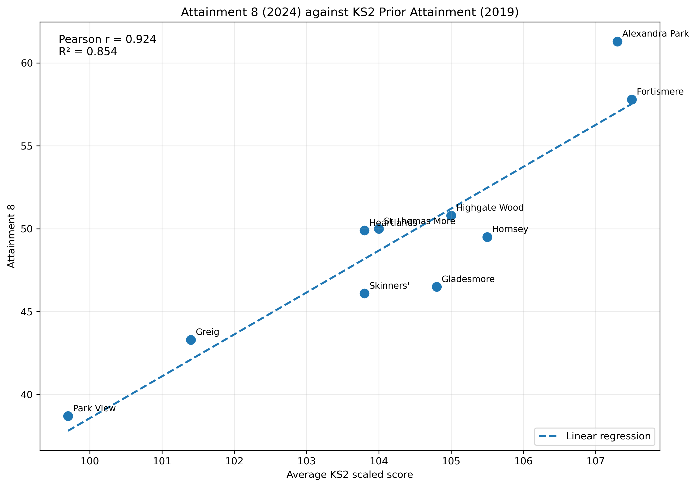
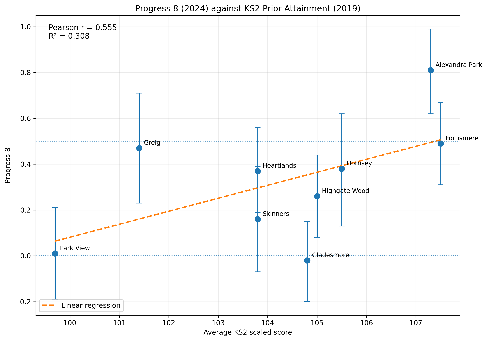
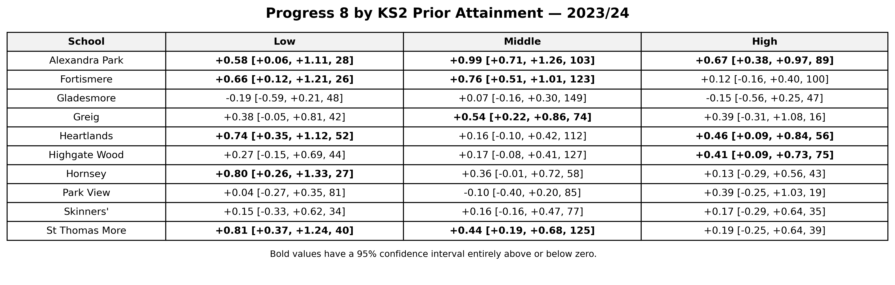
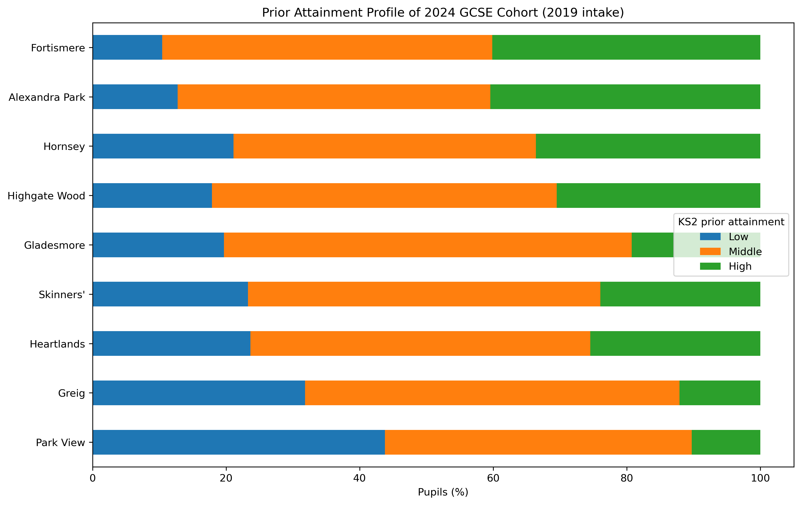
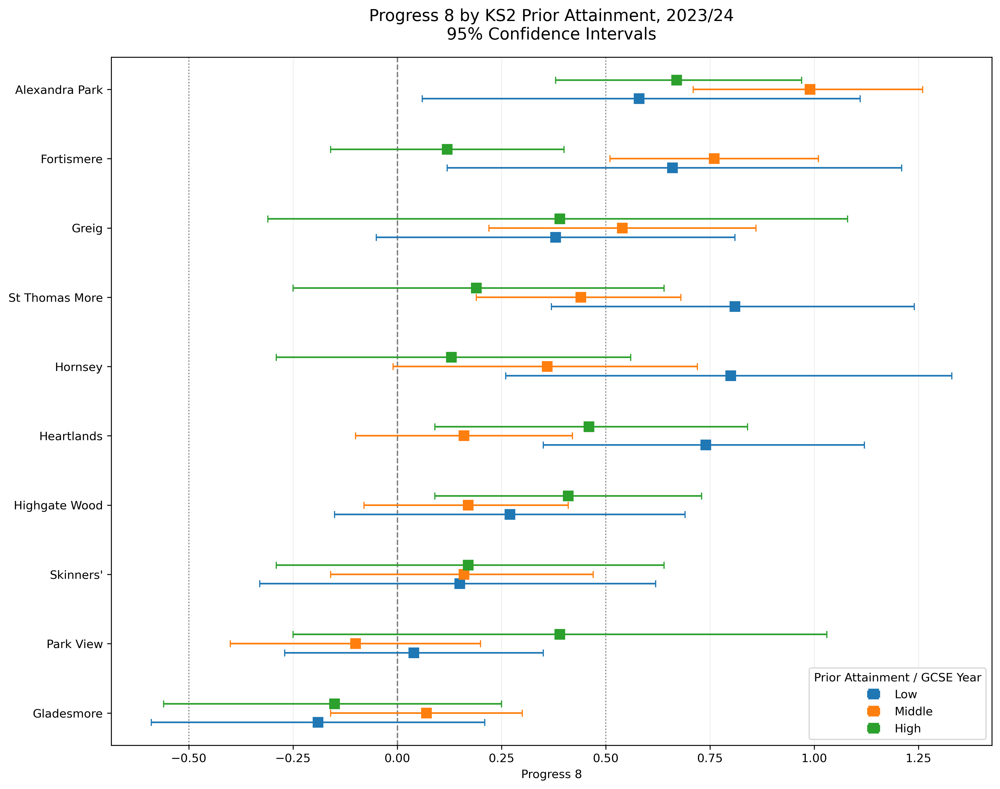
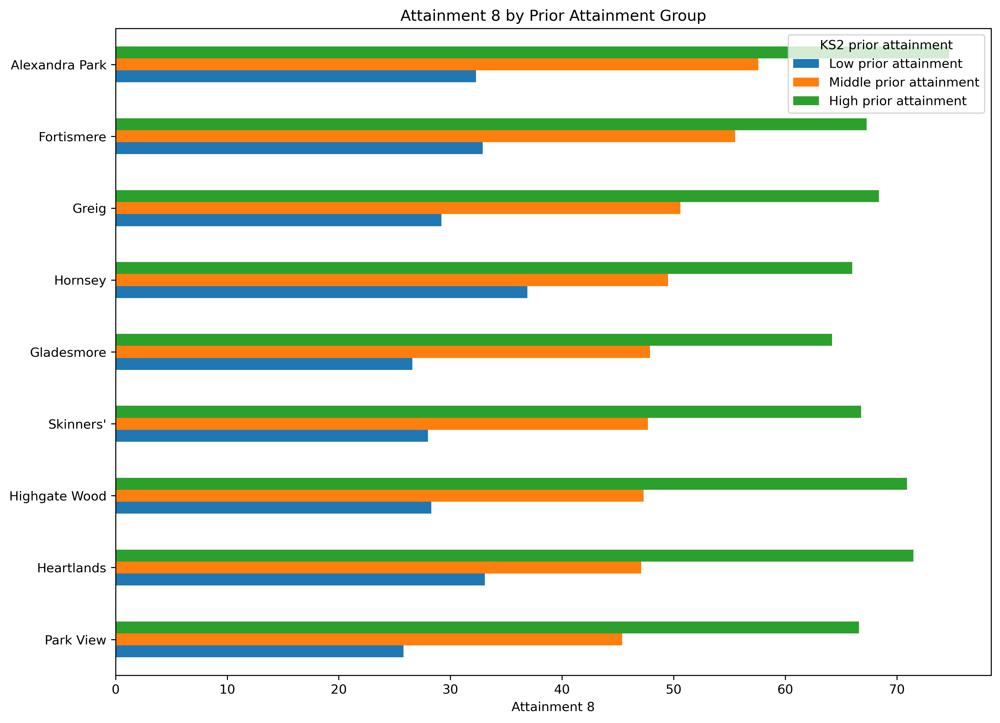
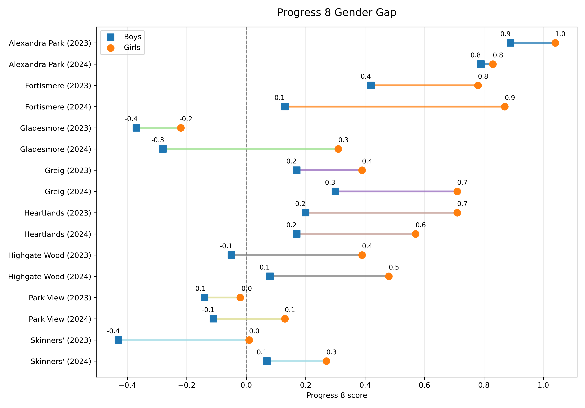
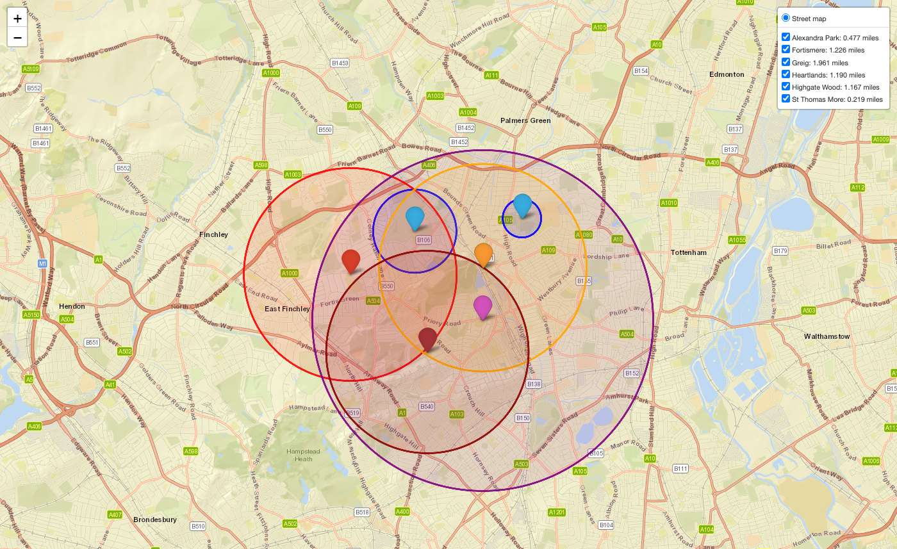
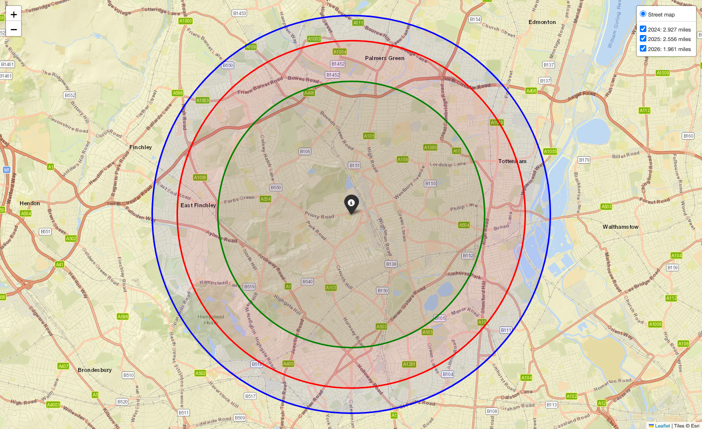

# highschool-performance

Analysis of English secondary school performance, applications and catchments, using Department for Education data.

Written to inform parent's choices in applying for year 7 places. 

## Output Report (Example)

A typical report (as a slide deck) is vailable in [Full Report](reports/full_report.pptx)

## Configuration

Configurations, such as which schools and years, to analyse are set in the JSON files under `src\config`. 

   - To change general settigns, edit `src/settings.json`
   - To add or change schools, including names, URNs, and addresses, edit `src/config/schools.json`
   - To add school catchment distances, typically available from authority websites, edit `src\catchment_distances.json`


## Setup

The conda environment is named `highschool-performance` and is defined in `environment.yml` (conda-forge, Python >= 3.13).

```bash
conda env create -f environment.yml
conda activate highschool-performance
```

If the environment already exists, update it:

```bash
conda env update -f environment.yml
```

Saving Folium catchment maps to PNG uses headless Chrome via Selenium. The helper looks for `chromium`, `chromium-browser`, or `google-chrome` on PATH, and for the macOS app bundles at `/Applications/Google Chrome.app` and `/Applications/Chromium.app` (and the same paths under the user Applications folder). conda-forge does not publish a `chromium` package for osx-64. On macOS, Google Chrome or Chromium installed as a normal app is enough. Selenium downloads a matching ChromeDriver itself.

## Run

To run the full pipeline, from `src/` run:

```bash
python -m app
```

With no flags, both data pipelines get their data and then plot it, and the slide deck is built. `--performance`, `--places`, or `--slides` selects a pipeline. `--get-data` or `--plot-data` selects a step. Leave a group unset to run all of that group. A get-data-only run does not build slides unless `--slides` is set. See [Slide decks](#slide-decks) for how the report is laid out and rebuilt.

```bash
python -m app --performance
python -m app --places
python -m app --slides
python -m app --performance --get-data
python -m app --places --plot-data
```

Each pipeline can also be run on its own:

```bash
python -m performance.run_performance
python -m places.run_places
python -m catchment.run_catchment
python -m report.run_reports
```

The catchment pipeline loads school coordinates and catchment distances from config, then writes catchment charts under `charts/`.

Raw and processed data are saved under `data/` and charts under `charts/`. Stored data will be used where it is available. To reprocess data, for example after a config change, delete the relevant files in `/data/processed/`. To re-download raw data from source, delete bothe processed data files in `data/processed/` and `data/raw/`.

## Slide decks

The report is a PowerPoint file. The default deck, `src/decks_layout/full_report.json`, is written to `reports/full_report.pptx`. Slides are filled from that JSON and from the PNG files in `charts/`, using the layouts in `templates/report_slides_template.pptx`.

Build it from `src/` once the charts exist:

```bash
python -m app --slides
python -m report.run_reports
python -m report.generate_slides
```

`python -m app` gets the data, plots the charts, then builds the deck. `--slides` only builds the deck, so every chart named in the JSON must already be in `charts/`.

A deck is a JSON list. Each slide has a `number`, a `layout`, and `shapes`. Numbers start at 1, are unique, and run without gaps. Slide 1 replaces the placeholder slide in the template. Later numbers are added after it.

The report uses `TITLE`, `SECTION_HEADER`, `TITLE_AND_BODY`, and `TITLE_ONLY`. The `layout` value must match a layout name in the template.

A chart slide is a title and a picture. `file` is the filename under `charts/`:

```json
{
    "number": 21,
    "layout": "TITLE_ONLY",
    "shapes": [
        {"type": "title", "text": "First Choice Applications Trend"},
        {"type": "picture", "file": "first_choice_applications.png"}
    ]
}
```

`text_box` holds paragraphs. A paragraph can be a `text` string, or `runs` with `bold`, `italic`, and `hyperlink`. Set `"bullet": true` for a bullet. `table` takes `rows`; the first row is the header when `"header": true`.

Slides reused across a deck, such as the school list, live in their own file next to `full_report.json` and are pulled in with `include`. The included file has `layout` and `shapes` only. Its slide number is set on the include. If the file is a list of slides, they take consecutive numbers from that starting number.

```json
{"number": 2, "include": "schools.json"}
```

To build another deck, from `src/` pass its JSON path or bare name. A bare name is read from `src/decks_layout`. The output file is `reports/<deck name>.pptx`.

```bash
python -m report.generate_slides full_report
```

## Layout

```
charts/                      saved charts
data/processed/              cleaned tables used for analysis
data/raw/                    downloaded source files
maps/                        saved maps
notebooks/                   exploratory analysis
reports/                     generated PowerPoint decks
templates/                   slide deck template
src/app.py                   entrypoint for the pipelines
src/catchment/               catchment maps
src/config/                  schools, years, and dataset URLs
src/data_models/             shared configuration model
src/decks_layout/            slide deck JSON
src/performance/             attainment and progress pipeline
src/places/                  applications and Year 7 roll pipeline
src/report/                  slide deck builder
src/shared_funcitons.py      download, load, and logging helpers
tests/                       tests
environment.yml              conda environment
LICENSE                      MIT license
pyproject.toml               project metadata
README.md                    this file
```

Downloaded files and generated images stay out of git. The folders are kept with `.gitkeep` files.

## Charts

Here are some indicative charts for a selection of schools in Haringey, London. 


### Attainment 8 (2024) against KS2 prior attainment (2019)




### Progress 8 (2024) against KS2 prior attainment (2019)




### Progress 8 (2024) against KS2 prior attainment (2019)

Key: P8[CI Upper, CI Lower, N]
CI: Confidence Interval at 95% level. 



### Prior Attainment Profile (KS2) for 2024 GCSE Cohort (2019 Intake)




### Progress 8 by KS2 prior attainment, 2022/23 and 2023/24




### Attainment 8 by prior attainment group




### Progress 8 by sex, 2022/23 and 2023/24




### All schools catchment distances, 2026 admissions




### Greig catchment distances by admissions year




